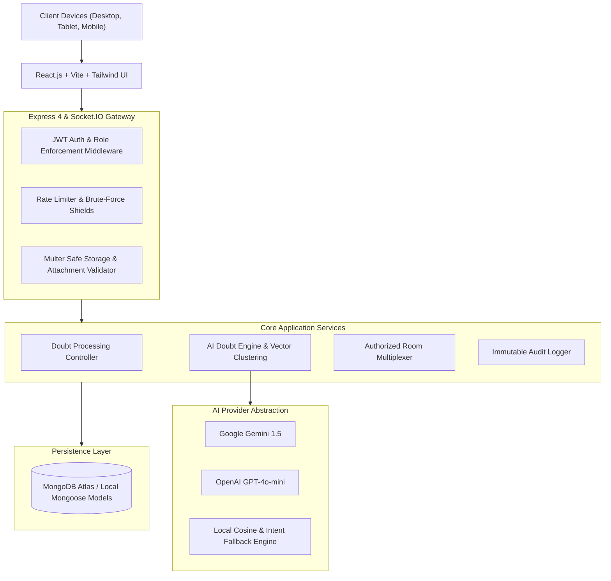
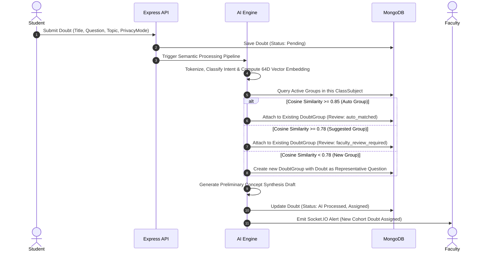

# AIDMS Architecture & Access-Control Specification

The **AI Doubt Management System (AIDMS)** is designed around strict institutional boundaries, semantic AI grouping, multi-class faculty routing, and privacy preservation.

---

## 1. System Architecture Diagram



---

## 2. Academic Hierarchy

The database schema strictly adheres to the institutional structure:

```
College (Apex Institute of Technology)
└── Department (Computer Science & Engineering)
    └── Program (B.Tech Computer Science)
        └── Classroom (CSE Sem 5 Section A, 2025-2026)
            ├── Student Enrollment (Aarav, Ananya)
            └── ClassSubject Offering (CS501 - Operating Systems)
                ├── Syllabus Topics & Subtopics (Deadlocks -> Banker's Algorithm)
                └── Faculty Assignment (Prof. Ramesh Sharma)
```

- **Independent Offerings:** Subjects are not rigidly bound to a single classroom. The `ClassSubject` entity independently links classrooms and subjects.
- **Dedicated Faculty Assignments:** The `FacultyAssignment` model specifies which faculty member teaches which subject in which class during which academic period.

---

## 3. AI Doubt Classification & Semantic Grouping Pipeline



---

## 4. Privacy & Access Control Matrix

| Role | Own Doubts | Class Cohort Doubts | Anonymous Submitter Identity | Cross-Class Doubts | Shared Faculty Explanations | Administrative Logs |
| :--- | :---: | :---: | :---: | :---: | :---: | :---: |
| **Student** | Full Access | No (Forbidden) | Hidden (Never returned) | No | View Approved Answers | No |
| **Faculty (Assigned)** | Full Access | Full Access | **Masked** (`Anonymous Student`) | No (Forbidden) | Author & Publish | No |
| **Faculty (Unassigned)** | No | No (403 Forbidden) | No (403 Forbidden) | No | Search Knowledge Base | No |
| **Administrator** | Audit Access | Audit Access | Policy Audited (Logged) | Managed | Full Management | Full Access |

### Critical Privacy Guarantees
1. **Server-Side Masking:** When a doubt is submitted in `anonymous` mode, the student's reference is preserved internally for ownership and private answers, but the server strips all identifying fields (`student._id`, `name`, `email`, `avatar`) from every faculty-facing API response and socket broadcast.
2. **Resource-Level Route Protection:** Students attempting to view other students' doubts by ID receive HTTP 403 Forbidden.
3. **Faculty Scope Enforcement:** Faculty members can only query or answer doubts belonging to their explicitly assigned `ClassSubject` combinations.
4. **Permanent Question Preservation:** When doubts are clustered into groups, original questions are permanently preserved. Faculty answers delivered to a group notify each linked student privately.
